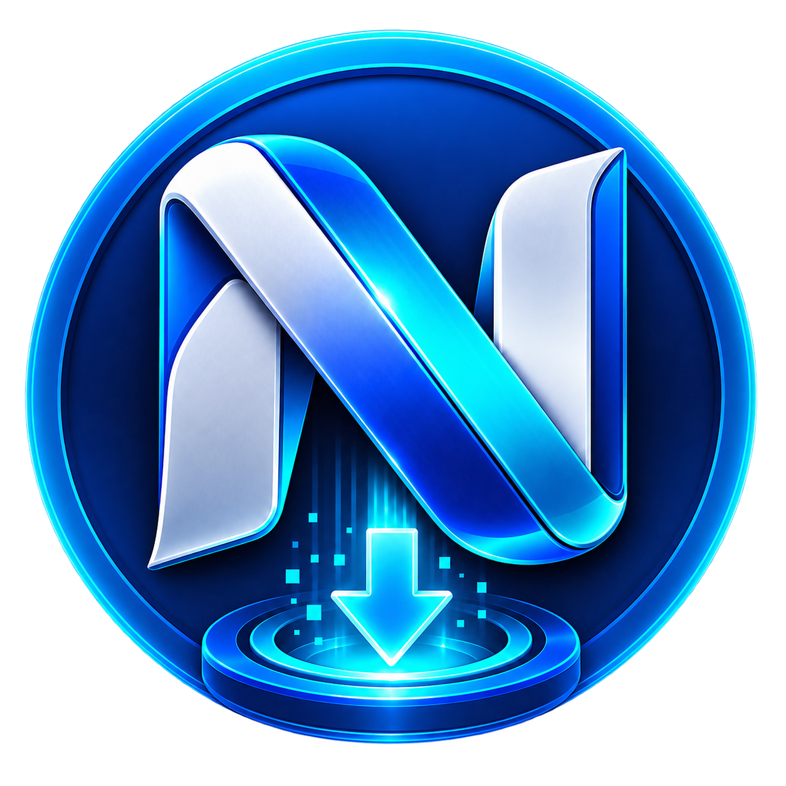

# NewzDeck

  

  <strong>A modern Usenet newsreader, downloader, and personal media automation app for Windows.</strong>

  <a href="https://www.newzdeck.com/">Website</a> &middot;
  <a href="https://github.com/newzdeckadmin/NewzDeck/releases/latest">Download</a> &middot;
  <a href="https://github.com/newzdeckadmin/NewzDeck/issues">Report an issue</a>

## Download

The current stable release is **NewzDeck v3.7.29** for 64-bit Windows.

**Recommended:** download `NewzDeck_v3.7.29_Setup.exe` from the [latest release](https://github.com/newzdeckadmin/NewzDeck/releases/latest).

A Portable ZIP is also available if you prefer to run NewzDeck without a normal installation.

NewzDeck is free and open source. **Usenet access is not included** - you need your own Usenet provider account. Automation and interactive NZB search can also use your own Newznab-compatible indexer.

## What NewzDeck does

- **Browse newsgroups visually** with gallery and list views, image/video previews, grouping, tabs, bookmarks, filtering, and search.
- **Download at high speed** through the bundled private SABnzbd engine with queue controls, retries, provider-aware transfers, PAR2 verification/repair, unpacking, and post-processing.
- **See downloads live** with near-real-time transfer state, stable Active cards, and live Verify, Repair, Unpack, and Smart Import progress.
- **Discover movies and TV** with TMDB-powered posters, backdrops, metadata, cast/crew, trending titles, new releases, recommendations, filtering, and responsive title details.
- **Automate TV and movies** with monitored libraries, quality profiles, Wanted items, calendar, history, root folders, and Newznab-compatible indexers.
- **Organize media** with Smart Import, including completed downloads and explicit external TV season/episode imports, canonical renaming/moving, duplicate/existing-media handling, and safe quality upgrades.
- **Keep downloads running in the background** with the Windows background service and system tray companion.

## v3.7.29 Metadata Refresh Reliability & Monitoring Integrity

Fixes the scheduler identifier bug that refreshed only the first monitored movie or TV series; verifies all monitored titles on upgrade. Live metadata fetches no longer silently accept stale local cached fallbacks. Failed titles retain good metadata and retry separately; Automation Health and title details display last-refresh status. See [release notes](release/RELEASE_NOTES_v3.7.29.md).

## v3.7.28 Windows Release Validation Recovery

Corrects the Windows CI validation error that prevented the already-tagged v3.7.27 source from producing a release. Removes the obsolete v3.7.26 full release gate from the current workflow, retains its targeted live-search tests, and preserves all v3.7.27 Downloads/Diagnostics improvements without changing the SAB engine. See [release notes](release/RELEASE_NOTES_v3.7.28.md).

## v3.7.27 Downloads Live Status Reliability & Responsiveness

Large Image Set submissions now yield to the UI, and Downloads receives fast bounded progress pulses from existing SAB in-memory samples between authoritative full snapshots. Diagnostics has an independent lightweight heartbeat and UI-lag telemetry. No download-engine changes or persistent search history/index. See [release notes](release/RELEASE_NOTES_v3.7.27.md).

## v3.7.26 High-Speed Entire Group Search

Entire Group search now uses bounded parallel live NNTP header ranges, adaptive chunking, early filtering and safe incremental results, with cancellable sockets. There is **no persistent header index, no automatic search history and no search-result caching on disk**. Search coverage and prior download safeguards remain unchanged. See [release notes](release/RELEASE_NOTES_v3.7.26.md).

## v3.7.25 Image Sets UI Refinement

With Image Sets OFF in Images, Videos or Images + Video, the Grouped Sets/Related Media side panel is now hidden, giving the main gallery/list more room. Switching Image Sets ON restores the panel without restarting; All Posts keeps its existing full-width layout. Includes dedicated browser-mode regression coverage and preserves v3.7.24 yEnc inspection reliability. See [release notes](release/RELEASE_NOTES_v3.7.25.md).

## v3.7.24 Binary Inspection Reliability Fix

Fixes multipart yEnc Identify for extensionless Raw Posts: the existing NNTP prefix reader called a nonexistent parser helper for `=ypart` headers. v3.7.24 calls the working helper and adds a real-parser regression test without changing queuing, fragment export, SAB runtime, or user data. See [release notes](release/RELEASE_NOTES_v3.7.24.md).

## v3.7.23 Obfuscated Binary Discovery & Recovery

All Posts / Raw Posts can now inspect an extensionless NNTP article on demand, inspect its yEnc part metadata and decoded prefix signature, and distinguish a likely single-file article from a multipart fragment. A likely complete article can use the ordinary queue; an incomplete fragment can instead be explicitly saved as a bounded `.part` file without being falsely treated as a complete download. Media signatures include common images, video containers, archives and other formats. No automatic 71,000-article BODY probe is performed. See [release notes](release/RELEASE_NOTES_v3.7.23.md).

## v3.7.22 Loose Video Filename Restoration

Newsgroups loose-video downloads now restore the known actual filename when SABnzbd uses NewzDeck's internal `NewzDeck Loose <token>` staging title. Single-file, exact token and matching video extension safeguards are preserved, with numbered collision-safe names and correct Completed display names. Images retain v3.7.17's restoration behavior; packages, NZB imports, Smart Import, download engine and v3.7.21 Image Sets remain unchanged. See [release notes](release/RELEASE_NOTES_v3.7.22.md).

## Requirements

- Windows 10 or Windows 11, 64-bit
- A Usenet provider account with NNTP server credentials
- Internet access for provider connections and online metadata
- Optional: a Newznab-compatible indexer for Automation and interactive NZB search

## Getting started

1. Download and run the latest **Setup.exe**.
2. Start NewzDeck.
3. Open **Settings** and add your Usenet provider details.
4. Browse or search newsgroups and start downloading.
5. If you want TV/movie automation, add your media root folders and configure a compatible indexer.

Your NewzDeck settings, history, queue state, provider configuration, and other persistent data are stored separately from the program files under `%LOCALAPPDATA%\NewzDeck`, so normal application updates preserve your data.

## Windows SmartScreen

NewzDeck is currently distributed **unsigned**, so Windows may show an **Unknown Publisher** or Microsoft Defender SmartScreen warning.

Only download NewzDeck from this repository or the official website. The release includes `NewzDeck_v3.7.29_SHA256.txt` so you can verify the installer and Portable ZIP before running them.

## Updating

Installed users should normally install the newest Setup.exe over their existing installation or use NewzDeck's verified update flow when offered.

Portable users should close NewzDeck before replacing the application files. See [UPDATING.txt](UPDATING.txt) for the short update guide.

## Troubleshooting and support

If something is not working, check NewzDeck's in-app status and diagnostic information first. When reporting a problem, include the NewzDeck version, what you were doing, what you expected to happen, and any relevant error message or screenshot.

[Open a GitHub issue](https://github.com/newzdeckadmin/NewzDeck/issues)

Please do **not** post Usenet passwords, API keys, tokens, or other private credentials in an issue.

## Open source

NewzDeck-owned source code in this repository is licensed under the **GNU General Public License v3.0 only (GPL-3.0-only)** unless a file or third-party notice says otherwise. See [LICENSE](LICENSE).

Third-party software, services, data, logos, and other assets retain their own licenses and terms. See [THIRD_PARTY_NOTICES.md](THIRD_PARTY_NOTICES.md).

For source-publication history and release provenance, see [docs/SOURCE_RELEASES.md](docs/SOURCE_RELEASES.md).

## Building from source

Most people do not need to build NewzDeck themselves. The official Windows binaries are built from the public source in this repository. Contributor build notes are available under [`release/windows/`](release/windows/README.md).
